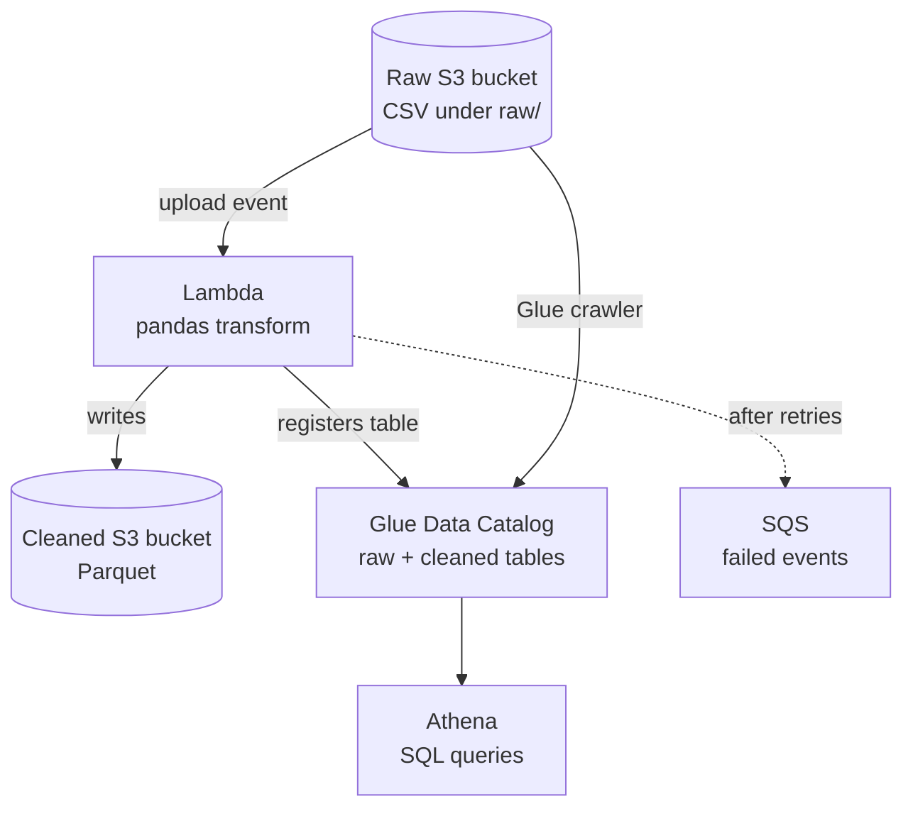

# AWS Serverless ETL Pipeline

<p align="center">
  
  
  
</p>

This project demonstrates a **serverless ETL pipeline** capable of ingesting, transforming, cataloging, and querying structured data.

---

## Overview
When a new CSV file is uploaded to an S3 bucket, an AWS Lambda function is automatically triggered.

The function uses pandas to transform the dataset, writes it as Parquet to a separate S3 bucket, and registers it in the AWS Glue Data Catalog.

A Glue crawler catalogs the raw data, so AWS Athena can query both datasets with SQL.

---

## [Demo](https://youtu.be/CyTrPDVRbM4)

---

## Architecture Diagram



---

## Deployment

**Prerequisites:** AWS CLI configured, Terraform installed.

**1. Provision infrastructure**
```sh
terraform init
terraform apply
```
Terraform packages the Lambda code and creates the S3 buckets, the Lambda function (using the AWS-managed AWS SDK for pandas layer) and its S3 trigger, the Glue database and raw-data crawler, an Athena workgroup, a log group with 14-day retention, and an SQS queue that captures failed events.

**2. Test the pipeline**
```sh
aws s3 cp sample_data/raw_data.csv s3://$(terraform output -raw raw_bucket)/raw/raw_data.csv
```
After a few seconds, query the cleaned data in Athena with the `etl-pipeline` workgroup:
```sql
SELECT * FROM etl_pipeline.cleaned;
```

**Expected:**

| name | age | city | source_file |
|---|---|---|---|
| Ryan | 30 | Charlotte | raw_data.csv |
| Palmer | 9 | Davidson | raw_data.csv |

Each file is its own partition, so uploading it again replaces its rows instead of duplicating them.

To compare with the raw data, run the crawler, then query `etl_pipeline.raw`:
```sh
aws glue start-crawler --name $(terraform output -raw raw_crawler)
```

**3. Tear down**
```sh
terraform destroy
```

---

## Testing

```sh
pip install -r requirements-dev.txt
pytest
```
